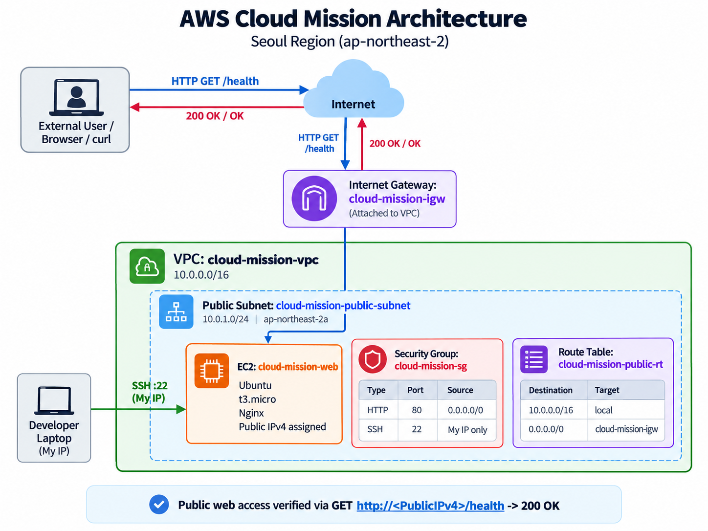
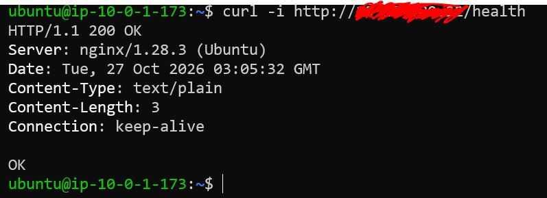

# AWS Cloud Mission — EC2 웹 서비스 인터넷 배포

**분야:** AI/SW 기초 · 클라우드와 AI API (필수, 40시간)  
**미션:** 내가 만든 웹사이트를 인터넷에 올려 누구나 쓰게 하기  
**리전:** AWS Seoul (`ap-northeast-2`)  
**구현:** VPC + Public Subnet + Internet Gateway + Route Table + Security Group + EC2(Ubuntu, Nginx)

## 1. 프로젝트 목적

AWS에서 직접 VPC 네트워크를 구성하고 EC2에 Nginx 기반 웹 서비스를 배포한다. 라우팅·공인 IP·Security Group의 관계를 이해하고, IAM 최소권한 접근, 외부 HTTP 응답 검증, 트러블슈팅 및 실습 후 리소스 정리까지 수행한다.

## 2. 아키텍처



### 실제 구성 정보

| 구분             | 이름·값                                                    | 상태/설명                                      |
| ---------------- | ---------------------------------------------------------- | ---------------------------------------------- |
| Region           | `ap-northeast-2`                                           | 서울                                           |
| VPC              | `cloud-mission-vpc` (`vpc-0f4332b567e230ef2`)              | `10.0.0.0/16`                                  |
| Public Subnet    | `cloud-mission-public-subnet` (`subnet-098f08891db67d8b5`) | `10.0.1.0/24`, `ap-northeast-2a`               |
| Internet Gateway | `cloud-mission-igw` (`igw-0012aedbb97eaeb2a`)              | VPC에 Attached                                 |
| Route Table      | `cloud-mission-public-rt` (`rtb-03eeb7c0aaa5e3028`)        | 서브넷 명시적 연결                             |
| Local Route      | `10.0.0.0/16 → local`                                      | 활성 확인                                      |
| Internet Route   | `0.0.0.0/0 → igw-0012aedbb97eaeb2a`                        | 활성 확인                                      |
| Security Group   | `cloud-mission-sg`                                         | HTTP(80) 전체, SSH(22) 지정 공인 IP `/32`      |
| EC2              | `i-0bbbb0474a0bf20d6`                                      | Ubuntu, `t3.micro`, 서울 2a                    |
| Web Server       | Nginx                                                      | 외부 응답 헤더 `nginx/1.28.3 (Ubuntu)` 확인    |
| IAM              | `cloud-mission-user`, 정책 `codyssey`                      | 정책 연결 및 실제 최소권한 범위 최종 점검 필요 |

**외부 트래픽 경로:** 사용자 → 인터넷 → Internet Gateway → EC2 퍼블릭 IPv4에 대응하는 사설 IP → Security Group 허용 → Nginx TCP 80 응답. Subnet의 Route Table이 `0.0.0.0/0` 목적지의 IGW 경로를 제공한다. Security Group은 접근을 제어하는 규칙이며 패킷이 순서대로 통과하는 별도 물리 장비는 아니다.

## 3. 프로젝트 구조

```text
aws-cloud-mission/
├── index.html
├── nginx/
│   └── default.conf
├── README.md
└── docs/
    ├── architecture.png
    ├── troubleshooting.md
    ├── cleanup-checklist.md
    └── screenshots/
        └── external-health.png  # 캡처 저장 후 포함
```

## 4. 배포 및 검증

### 4.1 Windows Git Bash에서 EC2 접속

```bash
# 실제 PEM 파일명과 EC2 퍼블릭 IPv4를 입력
KEY="/c/Users/kwonu/Desktop/ssh/<실제-키파일명>.pem"
IP="<EC2_PUBLIC_IPV4>"

chmod 600 "$KEY"
ssh -i "$KEY" "ubuntu@$IP"
```

> `IP="..."`로 먼저 변수를 지정해야 `$IP`가 실제 주소로 치환된다. 개인키(`.pem`)는 Git에 커밋하거나 공개하지 않는다.

### 4.2 Ubuntu 서버에 Nginx 설치

```bash
sudo apt update
sudo apt install -y nginx
sudo systemctl enable --now nginx
sudo systemctl status nginx
curl -i http://localhost
```

**실제 확인 결과:** `curl -i http://localhost` → `HTTP/1.1 200 OK`.

### 4.3 Windows Git Bash에서 파일 전송

EC2 SSH 터미널과 별도의 **로컬 Git Bash**에서 실행한다.

```bash
cd /d/aws-cloud-mission

# KEY, IP 변수는 해당 Git Bash 창에서도 다시 설정
KEY="/c/Users/kwonu/Desktop/ssh/<실제-키파일명>.pem"
IP="<EC2_PUBLIC_IPV4>"

scp -i "$KEY" index.html "ubuntu@$IP:/home/ubuntu/index.html"
scp -i "$KEY" nginx/default.conf "ubuntu@$IP:/home/ubuntu/default.conf"
```

EC2 SSH 터미널에서 파일을 적용한다.

```bash
sudo cp ~/index.html /var/www/html/index.html
sudo cp /etc/nginx/sites-available/default /etc/nginx/sites-available/default.bak
sudo cp ~/default.conf /etc/nginx/sites-available/default
sudo nginx -t && sudo systemctl reload nginx
```

### 4.4 외부 접속 검증 — **B 방식 채택**

- **검증 방식:** `GET http://<EC2_PUBLIC_IPV4>/health`
- **검증 당시 접속 URL:** `http://<EC2_PUBLIC_IPV4>/health` (**제출 전 실제 IP로 교체**)
- **검증 클라이언트:** Windows Git Bash (EC2 외부)
- **검증 일자:** 2026-10-27

```bash
IP="<EC2_PUBLIC_IPV4>"  # 실제 주소로 지정
curl -i "http://$IP/health"
```

**실제 관찰한 응답:**

```http
HTTP/1.1 200 OK
Server: nginx/1.28.3 (Ubuntu)
Date: Tue, 27 Oct 2026 03:05:32 GMT
Content-Type: text/plain
Content-Length: 3
Connection: keep-alive

OK
```

**외부 HTTP 200 / 응답 본문 OK 확인 완료.** 접속 결과 스크린샷은 `docs/screenshots/external-health.png`에 저장해야 하며, 실제 파일을 저장한 뒤 README에서 이미지 참조를 활성화한다.



> 자동 할당된 퍼블릭 IPv4는 인스턴스 중지·재시작 등으로 달라질 수 있다. 실습 종료 후 EC2를 삭제하면 해당 URL은 더 이상 접속되지 않으므로, 증빙은 검증 당시 결과로 취급한다.

### 4.5 추가 기능 요구사항 최종 확인

- [x] EC2 내부에서 `curl http://localhost` → `200` 확인
- [x] 외부에서 `GET /health` → `200 OK`, `OK` 확인
- [x] Public Subnet의 IGW 라우팅 경로 활성 확인
- [ ] **EC2 내부에서** `curl -I https://example.com` 성공 캡처 (아웃바운드 요구사항)
- [ ] SSH(22) 인바운드 소스가 현재 필요한 공인 IPv4 `/32`로만 제한된 상태 확인
- [ ] IAM 정책 `codyssey`가 실제로 연결됐는지, 불필요한 권한 및 `AdministratorAccess`가 없는지 확인
- [ ] EC2 스토리지의 크기 및 삭제 정책 확인
- [ ] 외부 응답 스크린샷 저장

## 5. 트러블슈팅

**문제:** SSH Security Group 소스에 `ipconfig`로 확인한 모바일 핫스팟의 사설 IP를 등록해 접속 실패.

**원인:** NAT 때문에 외부 AWS에서 관찰되는 출발지 공인 IPv4와 로컬 사설 IPv4가 달랐음.

**해결:** Windows PowerShell에서 다음 명령어로 공인 IPv4를 확인하고 Security Group의 SSH(TCP 22) 소스를 해당 주소의 `/32`로 변경한 뒤 SSH 접속 성공.

```powershell
curl.exe -4 https://checkip.amazonaws.com
```

상세한 증상·가설·검증·조치·결과·재발 방지는 [트러블슈팅 보고서](docs/troubleshooting.md)에 기록했다.

## 6. 보안 및 비용 관리

- HTTP(80): 전체 IPv4 허용 (`0.0.0.0/0`) — 공개 웹 서비스 요구사항
- SSH(22): 필요한 공인 IPv4 `/32`에서만 허용 — 변경된 네트워크에서는 주소 재확인
- IAM: 실습 전용 사용자와 EC2/VPC 관련 정책 사용. **최종 최소권한 확인 필요**
- AWS 리소스는 서울 리전에서 생성
- `.pem`, 임시 비밀번호, 액세스 키 등 비밀 정보는 저장소에 포함하지 않음
- **Billing 예산 설정은 생략했으므로**, 잔여 비용·IPv4·EBS·EC2 사용량 확인 필요

## 7. 제출 산출물 및 리소스 정리

| 제출물                 | 위치                                           | 상태                                 |
| ---------------------- | ---------------------------------------------- | ------------------------------------ |
| 아키텍처 다이어그램    | `docs/architecture.png`                        | 이미지 파일 배치·검토 필요           |
| 외부 접속 증빙         | `docs/screenshots/external-health.png`, README | 실제 화면 캡처 저장 필요             |
| 트러블슈팅 보고서      | `docs/troubleshooting.md`                      | 문서 작성 완료                       |
| 리소스 정리 체크리스트 | `docs/cleanup-checklist.md`                    | 문서 작성 완료, **실제 삭제 미완료** |

제출 증빙을 확보한 뒤 [리소스 정리 체크리스트](docs/cleanup-checklist.md)에 따라 EC2, EBS, 네트워크 구성요소 및 과금 대상 리소스를 삭제한다. 삭제가 끝나기 전까지 정리 완료로 표시하지 않는다.
