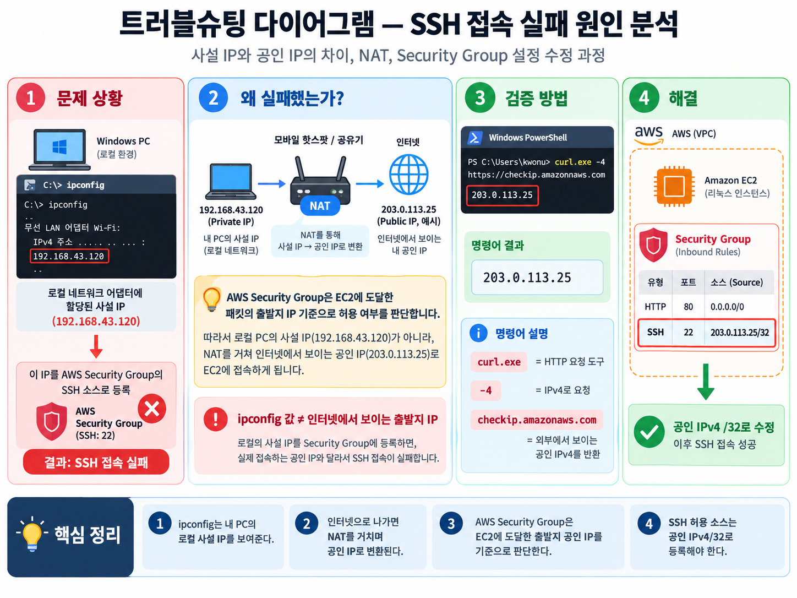

# 트러블슈팅 보고서 — SSH 접속 실패: 사설 IP와 공인 IP 혼동

- **작성일:** 2026-10-27
- **미션:** 내가 만든 웹사이트를 인터넷에 올려 누구나 쓰게 하기
- **환경:** AWS 서울 리전(`ap-northeast-2`), EC2 Ubuntu, VPC, Security Group, Windows PowerShell / Git Bash
- **관련 프로토콜:** SSH (TCP 22)
- **최종 결과:** SSH 접속 성공 및 웹 서버 정상 작동 확인



## 1. 증상 (Symptom)

EC2 인스턴스를 생성한 뒤 SSH 접속을 위해 Security Group에 **TCP 22번 포트를 특정 IP에만 허용**하는 인바운드 규칙을 설정했다. 처음에는 Windows에서 `ipconfig`로 확인한 IPv4 주소를 소스로 입력했으나, EC2에 SSH 접속할 수 없었다.

- 당시 연결 환경: 모바일 핫스팟 사용
- 최초 설정: `ipconfig`에 표시된 로컬 IPv4 주소를 SSH 인바운드 소스로 등록
- 관찰 결과: SSH 접속 실패
- **실제 SSH 오류 문자열 및 실패 시점 로그는 별도로 보존하지 않았으므로 보고서에 임의로 기재하지 않음**

## 2. 원인 가설 (Hypothesis)

`ipconfig`에서 확인한 주소가 인터넷에서 관찰되는 공인 IPv4가 아니라, 모바일 핫스팟 내부에서 노트북에 할당된 **사설 IPv4**일 가능성을 세웠다.

일반적으로 모바일 핫스팟에서는 노트북의 패킷이 핫스팟 및 이동통신사 네트워크의 NAT를 거쳐 인터넷으로 전달된다. 이때 외부 서버가 관찰하는 패킷의 출발지 공인 IPv4는 노트북의 사설 IPv4와 다를 수 있다.

AWS Security Group은 EC2로 **도달한 트래픽의 출발지 IP**를 인바운드 소스 규칙과 비교하므로, 인터넷에서 라우팅되지 않는 노트북 사설 IP만 허용하면 실제 외부 SSH 연결이 허용되지 않을 수 있다.

## 3. 검증 (Verification)

Windows PowerShell에서 아래 명령어로 로컬 네트워크 어댑터 주소를 확인했다.

```powershell
ipconfig
```

이어 외부 서비스가 관찰하는 출발지 **공인 IPv4**를 확인했다.

```powershell
curl.exe -4 https://checkip.amazonaws.com
```

두 명령어의 결과를 비교한 결과, `ipconfig`에 표시된 로컬 IP와 외부에서 확인된 공인 IPv4가 다름을 확인했다.

| 명령어                                      | 확인 대상                                   | 결론                             |
| ------------------------------------------- | ------------------------------------------- | -------------------------------- |
| `ipconfig`                                  | Windows 네트워크 어댑터에 할당된 IP         | 핫스팟 내부 사설 IPv4            |
| `curl.exe -4 https://checkip.amazonaws.com` | AWS 확인 서비스에 도착한 요청의 출발지 IPv4 | SSH 소스 제한에 사용할 공인 IPv4 |

**명령어 해석:** `curl.exe`는 Windows의 curl 실행 파일, `-4`는 IPv4 사용 강제, `https://checkip.amazonaws.com`은 외부에서 관찰한 클라이언트 IP 주소를 반환하는 엔드포인트다.

> 실제 IP 주소는 개인정보·접속 환경 보호를 위해 보고서 본문에 기록하지 않았다. 규칙은 AWS 콘솔에서 `/32` CIDR로 확인할 수 있다.

## 4. 조치 (Action)

1. 모바일 핫스팟에 연결한 상태에서 `curl.exe -4 https://checkip.amazonaws.com`을 실행했다.
2. 반환된 공인 IPv4에 `/32`를 붙여 **SSH(TCP 22) 인바운드 규칙의 소스**로 등록했다.
3. 기존에 잘못 추가한 사설 IPv4 기반 규칙을 제거했다.
4. SSH 연결을 다시 시도했다.

| 인바운드 유형 | 프로토콜 | 포트 | 소스                   |
| ------------- | -------- | ---: | ---------------------- |
| SSH           | TCP      |   22 | 확인한 공인 IPv4 `/32` |
| HTTP          | TCP      |   80 | `0.0.0.0/0`            |

교육장 Wi-Fi에서도 SSH를 사용한다면 해당 네트워크에서 별도로 확인한 공인 IPv4 `/32` 규칙을 추가할 수 있다. 광범위한 `0.0.0.0/0` SSH 허용은 사용하지 않는다.

## 5. 결과 (Result)

Security Group의 SSH 허용 소스를 실제 공인 IPv4로 수정한 뒤 **EC2 Ubuntu에 SSH 접속하는 데 성공**했다. 이후 EC2에서 Nginx를 설치·구성하여 아래 결과를 확인했다.

- EC2 내부: `curl -i http://localhost` → `HTTP/1.1 200 OK`
- 외부 Git Bash: `curl -i "http://$IP/health"` → `HTTP/1.1 200 OK`, 본문 `OK`
- 외부 응답 서버 헤더: `nginx/1.28.3 (Ubuntu)`

이 결과는 SSH 접속 문제 해결과 이후 웹 서비스 배포 성공을 보여준다. 다만 **HTTP 성공 자체가 SSH 오류 원인을 입증하는 것은 아니며**, SSH 소스 IP 교체 후 접속에 성공한 사실과 주소 비교 결과가 핵심 근거다.

## 6. 재발 방지 (Prevention)

- SSH 소스 IP 지정 시 `ipconfig` 출력값을 공인 IP라고 가정하지 않는다.
- 현재 연결된 네트워크에서 `curl.exe -4 https://checkip.amazonaws.com`으로 외부에 보이는 IPv4를 확인한다.
- Security Group의 SSH 소스에는 필요한 공인 IPv4만 `/32`로 등록한다.
- Wi-Fi ↔ 모바일 핫스팟 전환 시 공인 IP 변경 여부를 확인하고 더 이상 사용하지 않는 SSH 규칙은 제거한다.
- SSH 접속 장애 발생 시 **네트워크 연결 → 현재 공인 IP → Security Group 인바운드 → EC2 퍼블릭 IP 및 라우팅 → 서버 상태** 순으로 진단한다.
- 추후 재현 실험에서는 실패 명령어·오류 메시지·변경 전후 SG 규칙 화면·성공 결과를 함께 캡처한다.

## 7. 증빙 자료 (첨부 여부 확인)

제출 전에 실제 보유한 스크린샷만 `docs/screenshots/`에 저장하고 아래 항목을 확인한다.

- [ ] 수정 후 Security Group의 SSH 소스가 공인 IPv4 `/32`로 제한된 화면
- [ ] EC2 SSH 접속 성공 터미널 화면
- [x] 외부 `/health` 요청의 `200 OK / OK` 응답 확인 (대화에서 결과 확인)
- [ ] 해당 HTTP 응답 화면을 `docs/screenshots/external-health.png`로 저장

## 8. 학습 내용 및 결론

**사설 IP·공인 IP는 주소의 사용 범위를 구분하는 개념이고, NAT는 통신 중 패킷의 주소를 변환하는 동작이다.** 로컬 네트워크에서 보이는 주소와 AWS에서 관찰하는 출발지 IP는 다를 수 있다. 이번 사례에서는 이를 구분하고, 외부에서 확인한 공인 IPv4를 Security Group에 지정함으로써 SSH 접속 문제를 해결했다.
